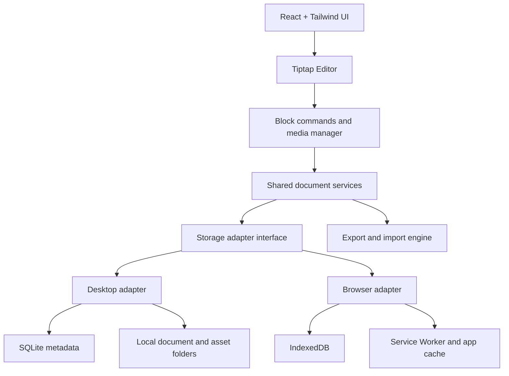

# Offline Multimedia Editor — Product and Technical Plan

## 1. Product vision

Build a local-first, Notion-style multimedia text editor that works as both:

- A desktop application for Linux, Windows, and macOS.
- An installable browser application (PWA) that supports offline use.

Users can write and format documents, organize content into blocks, insert images, videos, audio, links, PDFs, and other attachments, and keep their work on their own device without an account, cloud sync, or subscription.

The defining feature is **hybrid media storage**: small media items can be embedded in the document, while larger media items are stored as bundled local assets. The editor manages the distinction automatically.

## 2. Product goals

- Notion-like block editing with a clean, distraction-free interface.
- Fully usable offline after the application has been installed or initially loaded.
- Local-first storage and autosave.
- Support for text, images, video, audio, links, PDFs, and arbitrary attachments.
- Configurable thresholds for embedded versus bundled media.
- Portable documents that can move between desktop and browser versions.
- Export to PDF, HTML, Markdown, and a native package.
- No account service or cloud document/media sync. Keep all current application features usable without network access after installation.

## 3. Recommended technology stack

| Layer | Recommendation | Purpose |
|---|---|---|
| UI | React + TypeScript | Shared application interface |
| Build tooling | Vite | Fast development and common build setup |
| Styling | Tailwind CSS | Responsive, themeable UI |
| Rich-text engine | Tiptap + ProseMirror | Extensible rich-text and block editing |
| Desktop shell | Electron | Installable Linux, Windows, and macOS app |
| Browser version | PWA + Service Worker | Installable browser app and offline application shell |
| Browser database | IndexedDB via Dexie | Document records, metadata, and binary media |
| Desktop metadata | SQLite | Document and asset metadata |
| Desktop media storage | Local filesystem | Large assets and active document workspaces |
| Document model | Versioned JSON schema | Structured editable content |
| Export/import | Shared package and export services | Native packages and portable formats |
| Testing | Vitest + Playwright | Unit, integration, and end-to-end testing |
| Workspace | pnpm monorepo | Shared packages between desktop and browser apps |

### Architecture note

The desktop app and PWA should share the editor, document schema, validation, storage policy, and export logic. Their storage adapters will differ.

A browser app cannot freely access arbitrary folders on a computer. It should use IndexedDB for its managed workspace and, where supported, offer a user-selected folder workflow. The desktop app can access the filesystem through a restricted Electron preload API and validated IPC calls.

For Electron, keep Node.js integration disabled in the renderer, and enable context isolation and sandboxing.

## 4. High-level architecture



### Architectural rules

1. The editor never accesses the filesystem directly. It uses shared document and media services.
2. The desktop adapter uses a restricted Electron preload API and validated IPC calls.
3. The browser adapter uses IndexedDB for document records and binary media, with a service worker to cache the application shell for offline launches.
4. Import and export operate on the same versioned document schema on every platform.
5. Platform-specific storage details must not leak into the editor's content model.
6. Asset references use stable IDs rather than hard-coded absolute paths.
7. The current application has no backend or account boundary. Future online services are out of scope unless they can remain strictly optional and preserve local ownership.

## 5. Core user experience

### Notion-like editing

- Clean document canvas and collapsible sidebar.
- Pages/documents organized in a local workspace.
- Slash-command menu for inserting blocks.
- Drag-and-drop block reordering.
- Rich-text formatting, headings, lists, quotes, and tables.
- Inline links and media previews.
- Light and dark themes.
- Keyboard shortcuts, undo/redo, and find/replace.

### Multimedia support

- Images with captions and resize controls.
- Local video playback.
- Local audio playback.
- Hyperlinks.
- PDFs and arbitrary file attachments.
- Drag-and-drop file import.
- Paste images from the clipboard where supported.
- File metadata and missing-asset warnings.

A remote hyperlink can be stored offline, but its destination will not become available offline unless the relevant page or media has been saved locally. Local media can play offline if the device supports its format.

## 6. Hybrid storage model

The editor supports both embedded media and bundled local assets.

### Initial configurable defaults

- **Per-item embedding threshold:** 5 MB.
- **Total embedded-media budget per document:** 20 MB.

These are starting defaults, not hard technical limits. Both should be configurable in Settings.

| Condition | Default behavior |
|---|---|
| Media item at or below the per-item threshold | Eligible for embedded storage |
| Media item above the per-item threshold | Store as a bundled local asset |
| Total embedded media exceeds the document budget | Migrate eligible embedded items to bundled storage |
| User explicitly selects a storage mode | Respect the choice where practical |
| Media is needed for a portable export | Include it in the exported package |

Thresholds should be calculated using original binary size, not Base64-encoded size. Base64 increases payload size by roughly one-third.

### Embedded media

Embedded media belongs to the document's embedded-media collection. It is convenient for small images, icons, and short audio clips.

### Bundled media

Bundled media is stored as a separate file inside the document package. It is more practical for high-resolution images, long videos, and large audio recordings.

### Example native package

```text
My-Travel-Journal.mmdoc
├── manifest.json
├── document.json
├── embedded/
│   ├── small-image.webp
│   └── short-audio.mp3
└── assets/
    ├── trek-video.mp4
    ├── panorama.jpg
    └── voice-note.wav
```

The application presents this as one document. Internally, the manifest tracks each asset's ID, location, media type, size, and checksum.

For active editing, the app can use an efficient local working directory. It can package the document and its bundled assets into a ZIP-based `.mmdoc` file when saving a portable copy or exporting.

### Migration and integrity rules

When media crosses a threshold:

1. Write the new asset to a temporary location.
2. Validate size, media type, and checksum.
3. Update the document's asset reference.
4. Commit the updated document.
5. Remove obsolete data only after a successful commit.

This prevents interrupted migrations from leaving broken media references. Add recovery checkpoints and user-visible backup options.

## 7. Document data model

Use structured blocks rather than storing the document as one flat HTML string. Tiptap's JSON document can be the underlying content model, with application-specific attributes for block IDs and assets.

Illustrative schema:

```json
{
  "schemaVersion": 1,
  "id": "document-id",
  "title": "My Travel Journal",
  "blocks": [
    {
      "id": "block-1",
      "type": "heading",
      "level": 1,
      "content": "Day 1 — The mountains"
    },
    {
      "id": "block-2",
      "type": "paragraph",
      "content": "The trek began early in the morning."
    },
    {
      "id": "block-3",
      "type": "image",
      "assetId": "asset-123",
      "caption": "Mountain trail"
    },
    {
      "id": "block-4",
      "type": "video",
      "assetId": "asset-456"
    }
  ]
}
```

This is an illustration, not the final validation contract. Define a formal schema, validate every imported document, and version the schema so future migrations are possible.

## 8. MVP feature checklist

### Editor

- [ ] Rich text: headings, paragraphs, bold, italic, lists, and quotes.
- [ ] Block insertion with a slash-command menu.
- [ ] Drag-and-drop block reordering.
- [ ] Undo/redo and keyboard shortcuts.
- [ ] Find and replace.

### Multimedia

- [ ] Insert images with captions and resize controls.
- [ ] Embed local video and audio with native playback controls.
- [ ] Add hyperlinks, PDFs, and arbitrary file attachments.
- [ ] Paste images and import files using a file picker.

### Offline and storage

- [ ] Autosave and crash recovery.
- [ ] Hybrid embedded/bundled storage and configurable thresholds.
- [ ] Document search, rename, duplicate, and delete.
- [ ] Import/export portable document packages.
- [ ] Storage usage indicator and missing-asset warnings.

### Export and polish

- [ ] PDF export.
- [ ] HTML export.
- [ ] Markdown export with a companion asset folder.
- [ ] Light/dark theme and keyboard accessibility.
- [ ] Cross-platform document compatibility tests.

### Defer until later

- Real-time collaboration.
- Cloud synchronization.
- Plugin marketplace.
- AI writing features.
- Mobile-specific layouts.

These are not needed to validate the core offline editing experience.

The account API and signup flow were removed to keep the application backend-free and fully local. SQLite remains a planned storage option for a future desktop build, not a current dependency.

## 9. Export and import strategy

| Format | Intended use | Media behavior |
|---|---|---|
| `.mmdoc` | Native editable document | Packages document and all media |
| PDF | Portable reading and printing | Renders supported media as static content or links where appropriate |
| HTML | Portable interactive reading | Can include local assets in a companion folder or use self-contained embedding where practical |
| Markdown | Plain-text-compatible portability | Stores media references and exports a companion assets folder |

Do not promise that every media type will remain interactive in every export format. For example, PDF generally cannot provide the same embedded video/audio experience as the editor. Make export behavior explicit in the UI.

## 10. Repository structure

```text
offline-editor/
├── apps/
│   ├── web/                  # PWA
│   └── desktop/              # Electron main and preload
├── packages/
│   ├── editor/               # Shared React + Tiptap editor
│   ├── document-core/        # Schema, validation, migrations
│   ├── storage-core/         # Hybrid policy and asset registry
│   ├── storage-browser/      # IndexedDB implementation
│   ├── storage-desktop/      # SQLite + filesystem implementation
│   ├── export/               # PDF, HTML, Markdown, native package
│   └── ui/                   # Shared UI components
├── tests/
│   ├── unit/
│   ├── integration/
│   └── e2e/
└── package.json
```

Use a pnpm workspace monorepo so the browser and desktop apps share the same editor and business logic. Vite is a simpler common build choice than adding Next.js server-side rendering to a local-first editor.

## 11. Implementation roadmap

A realistic initial estimate is **4–6 weeks for one developer**, assuming full-time work and a limited export scope. Packaging, cross-platform testing, and robust document migration can extend the timeline.

### Week 1 — Foundation and interface

- Set up React, TypeScript, Vite, Tailwind, Tiptap, and shared types.
- Build the sidebar, document list, blank canvas, theme, and toolbar.

**Deliverable:** Functional writing interface.

### Week 2 — Block editing and media

- Implement slash commands and block insertion.
- Add image, audio, video, and attachment handling.
- Add captions, resizing, and drag-and-drop.

**Deliverable:** Mixed text-and-media documents.

### Week 3 — Persistence and hybrid storage

- Build the storage abstraction and asset registry.
- Implement threshold policies, autosave, and recovery.
- Implement `.mmdoc` import/export.

**Deliverable:** Documents survive restarts and can be moved between computers.

### Week 4 — Offline browser and desktop

- Configure the PWA service worker and IndexedDB adapter.
- Integrate the Electron shell and desktop filesystem adapter.
- Verify that the application launches and works without a network connection after installation or initial setup.

**Deliverable:** Offline operation on both platforms.

### Weeks 5–6 — Export, hardening, and packaging

- Add PDF, HTML, and Markdown exports.
- Test large media, migration, and crash recovery.
- Handle missing assets and malformed imports.
- Produce desktop installers and run cross-platform tests.

**Deliverable:** Distributable MVP with tested import/export workflows.

## 12. Key engineering risks and mitigations

| Risk | Mitigation |
|---|---|
| Browser storage quota or eviction | Monitor storage, request persistence where supported, and provide exports and backups |
| Broken media after moving files | Use stable asset IDs and managed paths |
| Large-document performance | Lazy-load media, virtualize long lists, and avoid repeatedly serializing binary assets |
| Interrupted saves | Use atomic writes, recovery checkpoints, and a journal for multi-file operations |
| Unsafe imported content | Sanitize HTML, validate media types, and prevent imported documents from executing scripts |
| Browser/desktop incompatibility | Test identical document fixtures and import/export workflows against both adapters |
| Export differences | Document format-specific limitations and test exported media references |

For Electron, follow its security model: context isolation, sandboxing, restricted preload APIs, and validation of IPC calls.

## 13. Definition of done

The MVP should pass these end-to-end tests:

1. Create a document, add formatted text, and insert an image, local video, audio recording, and hyperlink.
2. Disconnect from the internet, restart the application, and verify the document and locally stored media remain usable.
3. Add media above the configured threshold and verify migration does not break references.
4. Export a native package, import it on the other platform, and compare content and media.
5. Simulate an interrupted save and verify recovery without data loss.
6. Export to PDF, HTML, and Markdown and confirm media is preserved or referenced correctly for each format.
7. Import malformed or untrusted documents and verify that the application rejects unsafe content.
8. Verify that the browser app can launch offline after its initial installation/setup.

## 14. Recommended development order

Build the shared editor and document schema first, then implement the desktop filesystem adapter and browser IndexedDB adapter. Keep the native `.mmdoc` package independent of the underlying platform.

The first milestone should be a working vertical slice:

**Create a document → write text → insert media → autosave → close → reopen offline → export and import.**

Once this works reliably, add the remaining interface and formatting features incrementally.

## 15. Reference documentation

- Tiptap: https://tiptap.dev/
- Electron security: https://www.electronjs.org/docs/latest/tutorial/security
- MDN IndexedDB: https://developer.mozilla.org/en-US/docs/Web/API/IndexedDB_API
- MDN Service Workers: https://developer.mozilla.org/en-US/docs/Web/API/Service_Worker_API
- Vite: https://vite.dev/
- Dexie: https://dexie.org/
- Playwright: https://playwright.dev/
